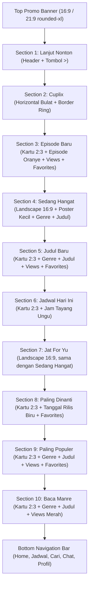

# DESIGN.md: Arsitektur & Spesifikasi UI Halaman Home (AnimeIn Android)

Dokumen ini mendefinisikan arsitektur desain, tata letak antarmuka, dan sistem desain untuk halaman **Home** aplikasi Android **AnimeIn**. Seluruh spesifikasi disusun berdasarkan referensi visual dan aturan ketat anti-slop dari `.agents/skills/anti-slop/SKILL.md`.

---

## 1. Identitas Visual & Liveliness Dials

Sesuai aturan *Part 3: Liveliness Toolkit* pada `SKILL.md`:

```text
Reading this as: Native Android Anime Streaming & Short Video App for Indonesian anime community, in a dense content-focused matte dark style, dial ENERGY 2 / RHYTHM 2 / MOTION 1.
```

* **ENERGY 2 (Balanced):** Tampilan gelap pekat bersih (*clean matte dark*), memprioritaskan karya seni poster anime dan thumbnail video, bebas dari efek dekoratif semrawut, border tebal tak berguna, atau gradien ungu-biru generik.
* **RHYTHM 2 (Structured & Varied):** Variasi ritme visual yang natural antar seksi (Banner Promo 16:9/21:9, Avatar Bulat Cuplix, Kartu Vertikal 2:3, Kartu Landscape Lebar 16:9, dan Kartu dengan Badge Spesifik).
* **MOTION 1 (Functional & Responsive):** Animasi fungsional (shimmer loading skeleton terukur, paging carousel mulus, dan touch feedback Material Ripple standar).

---

## 2. Tema & Palet Warna (Anti-Slop Dark UI)

Semua warna memiliki tujuan fungsional yang jelas dan memenuhi standar kontras WCAG AA (R-25):

| Token Warna | Nilai Hex | Fungsi & Keterangan |
| :--- | :--- | :--- |
| **Background Utama** | `#0B0B0B` / `#101010` | Hitam pekat bersih tanpa tumpukan kotak ber-border abu-abu tebal. Menjadi kanvas tunggal yang solid. |
| **Warna Aksen Utama** | `#FF5722` / `#FF6D3F` | Oranye kemerahan untuk teks episode, genre, border aktif, dan tab navigasi aktif. |
| **Indikator Views** | `#EF4444` | Ikon mata & teks merah untuk total penayangan (views) anime dan bacaan. |
| **Indikator Favorites** | `#FACC15` | Ikon bintang & teks kuning emas untuk metrik favorit pengguna. |
| **Indikator Jam Tayang** | `#A855F7` | Ikon jam & teks ungu pada seksi `Jadwal Hari Ini` (contoh: `10:00`). |
| **Indikator Tanggal Rilis** | `#3B82F6` | Ikon kalender & teks biru pada seksi `Paling Dinanti` (contoh: `2026-10-01`). |
| **Teks Primer** | `#FFFFFF` | Judul anime dan nama seksi (putih tebal, kontras tinggi). |
| **Teks Sekunder** | `#9CA3AF` | Keterangan tambahan dan teks pendukung. |
| **Background Nav / Control** | `#161616` | Background lingkaran gelap untuk tombol panah chevron dan bar navigasi bawah. |
| **Border Pemisah Tipis** | `rgba(255, 255, 255, 0.08)` | Garis batas 1dp tipis hanya untuk pemisah Bottom Nav (tanpa border tebal pada kartu). |

---

## 3. Tipografi & Ukuran Interaksi (Ergonomi Mobile)

* **Font Family:** San-Serif Sistem Android (Inter / Roboto).
* **Section Header:** 16sp, Semi-Bold, teks warna `#FFFFFF`.
* **Anime Title:** 12sp - 13sp, Bold, warna `#FFFFFF`, maksimal 2 baris dengan `ellipsize="end"`.
* **Tag Episode / Genre:** 11sp, Semi-Bold, warna `#FF5722` (Oranye kemerahan).
* **Statistik & Indikator:** 10sp, Medium, teks inline dengan ikon masing-masing metrik.
* **Touch Target:** Seluruh area interaktif (tombol panah, avatar Cuplix, kartu anime, dan menu navigasi) memiliki ukuran minimal 48dp x 48dp (R-03 & R-39).
* **Padding & Margin:**
  * Margin horizontal layar: 16dp.
  * Jarak vertikal antar seksi: 20dp.
  * Jarak horizontal antar kartu di carousel: 10dp.

---

## 4. Urutan Komponen Halaman Home (Dari Atas ke Bawah)

Struktur antarmuka halaman Home tersusun secara berurutan dan mengalir secara presisi:



---

### Rincian Spesifikasi Setiap Komponen:

### 1. Top Promo Banner
* **Rasio Gambar:** `16:9` atau `21:9` selebar layar (dengan margin 16dp kiri dan kanan) di bagian paling atas.
* **Bentuk:** Sudut membulat modern (`rounded-xl` / 14dp radius).
* **Tampilan:** Gambar banner promosi event, mini games, atau pengumuman fitur penting dengan rendering tajam.
* **Aksi:** Membuka detail promo / event yang bersangkutan saat diklik.

### 2. Section `Lanjut Nonton`
* **Header Seksi:**
  * Sisi kiri: Teks judul "Lanjut Nonton" (16sp, putih tebal).
  * Sisi kanan: Tombol ikon panah chevron `>` dengan background lingkaran gelap (`#161616`, diameter 32dp, touch target 48dp).
* **Konten:** 
  * Carousel horizontal episode terakhir yang ditonton beserta bilah progress pemutaran.
  * Jika riwayat tontonan kosong, seksi disembunyikan otomatis (*GONE*) untuk menghemat ruang vertikal (C-3).

### 3. Section `Cuplix`
* **Karakter Visual:** Baris horizontal berisi item bulat/lingkaran (diameter 60dp).
* **Ring Border:** Border ring tipis (1.5dp) berwarna aksen (`#FF5722` / oranye atau aksen status baru).
* **Isi:** Cuplikan video pendek yang diambil dari endpoint Cuplix (`/data/fyp2/list_scroll`).
* **Aksi:** Mengetuk salah satu lingkaran langsung memutar video reel vertikal Cuplix (endpoint `/data/fyp/server`).

### 4. Section `Episode Baru`
* **Karakter Visual:** Baris horizontal kartu poster vertikal dengan rasio `2:3`.
* **Prinsip Bersih (Anti-Slop):** Di bawah poster **tanpa background card yang kaku** atau box ber-border tebal. Konten langsung menyatu dengan canvas utama:
  1. Teks Oranye (`#FF5722`): `Episode [Nomor]` (11sp Semi-Bold).
  2. Judul Anime: Putih tebal (12sp Bold, maksimal 2 baris, `ellipsis`).
  3. Baris Statistik:
     * Baris Views: Ikon mata & teks Merah (`#EF4444`).
     * Baris Favorites: Ikon bintang & teks Kuning Emas (`#FACC15`).

### 5. Section `Sedang Hangat`
* **Karakter Visual:** Baris horizontal kartu landscape lebar dengan rasio `16:9` (lebar ~240dp, sudut membulat 10dp).
* **Struktur Tata Letak di Bawah Gambar Banner Lebar:**
  * **Sisi Kiri:** Poster kecil vertikal (rasio 2:3, lebar ~36dp, tinggi ~54dp, sudut membulat 4dp).
  * **Sisi Kanan:** 
    * Baris 1: Teks Genre warna Oranye (`#FF5722`, 10sp).
    * Baris 2: Judul Anime warna Putih tebal (12sp Bold, 1 baris terpotong rapi).
    * Baris 3: 1 baris terpadu berisi Views (ikon mata + teks merah `#EF4444`) dan Favorites (ikon bintang + teks kuning emas `#FACC15`).

### 6. Section `Judul Baru`
* **Karakter Visual:** Kartu poster vertikal (`2:3`) tanpa background box kaku.
* **Elemen Informasi (Di Bawah Poster):**
  1. Genre: Teks warna Oranye (`#FF5722`, 11sp).
  2. Judul Anime: Teks warna Putih tebal (12sp, maksimal 2 baris).
  3. Views: Ikon mata & teks Merah (`#EF4444`).
  4. Favorites: Ikon bintang & teks Kuning Emas (`#FACC15`).

### 7. Section `Jadwal Hari Ini`
* **Karakter Visual:** Kartu poster vertikal (`2:3`) tanpa background box kaku.
* **Elemen Informasi (Di Bawah Poster):**
  1. Genre: Teks warna Oranye (`#FF5722`, 11sp).
  2. Judul Anime: Teks warna Putih tebal (12sp, maksimal 2 baris).
  3. Views: Ikon mata & teks Merah (`#EF4444`).
  4. Favorites: Ikon bintang & teks Kuning Emas (`#FACC15`).
  5. Jam Tayang: Ikon jam & teks Ungu (`#A855F7`, contoh: `10:00`).

### 8. Section `Jat For Yu`
* **Karakter Visual:** Layout kartu landscape lebar yang sama persis dengan Section `Sedang Hangat`:
  * Banner lebar horizontal rasio `16:9`.
  * Di bawah banner lebar terdapat: Poster kecil vertikal di sisi kiri, di sisi kanannya terdapat genre (oranye), judul anime (putih tebal), dan 1 baris views (merah) + favorites (kuning).

### 9. Section `Paling Dinanti`
* **Karakter Visual:** Kartu poster vertikal (`2:3`) tanpa background box kaku.
* **Elemen Informasi (Di Bawah Poster):**
  1. Genre: Teks warna Oranye (`#FF5722`, 11sp).
  2. Judul Anime: Teks warna Putih tebal (12sp, maksimal 2 baris).
  3. Tanggal Rilis: Ikon kalender & teks Biru (`#3B82F6`, contoh: `2026-10-01`).
  4. Favorites: Ikon bintang & teks Kuning Emas (`#FACC15`).

### 10. Section `Paling Populer`
* **Karakter Visual:** Kartu poster vertikal (`2:3`) tanpa background box kaku.
* **Elemen Informasi (Di Bawah Poster):**
  1. Genre: Teks warna Oranye (`#FF5722`, 11sp).
  2. Judul Anime: Teks warna Putih tebal (12sp, maksimal 2 baris).
  3. Views: Ikon mata & teks Merah (`#EF4444`, angka penonton views jutaan).
  4. Favorites: Ikon bintang & teks Kuning Emas (`#FACC15`).

### 11. Section `Baca Manre`
* **Karakter Visual:** Kartu poster vertikal (`2:3`) untuk katalog manga/manhwa/komik.
* **Elemen Informasi (Di Bawah Poster):**
  1. Genre: Teks warna Oranye (`#FF5722`, 11sp).
  2. Judul: Teks warna Putih tebal (12sp, maksimal 2 baris).
  3. Views: Ikon buku/mata & teks Merah (`#EF4444`) untuk statistik pembaca.

### 12. Bottom Navigation Bar
* **Penempatan:** Menempel tetap di bagian paling bawah layar (*Fixed Bottom Bar*).
* **Background:** Hitam pekat solid (`#0B0B0B` / `#101010`) dengan garis pemisah tipis 1dp `rgba(255, 255, 255, 0.08)`.
* **5 Menu Navigasi:**
  1. `Home`: Ikon Rumah (Status Aktif: Teks & Ikon warna Oranye `#FF5722`).
  2. `Jadwal`: Ikon Kalender / Jadwal rilis (Warna `#9CA3AF`).
  3. `Cari`: Ikon Kaca Pembesar / Explore (Warna `#9CA3AF`).
  4. `Chat`: Ikon Balon Pesan / Diskusi (Warna `#9CA3AF`).
  5. `Profil`: Ikon User / Pengaturan (Warna `#9CA3AF`).
* **Ergonomi:** Tinggi bar 56dp - 64dp, dengan touch target setiap item minimal 48dp x 48dp (R-03 & R-39).

---

## 5. Pemetaan Endpoint Data API ke Komponen UI

Seluruh data komponen dihubungkan langsung ke scraper dan API yang tersedia di workspace:

| Komponen Home | Endpoint Sumber Data | Field Data Utama |
| :--- | :--- | :--- |
| **Top Promo Banner** | `GET /3/2/home/data` (`data.slider`) | `image`, `title`, `link`, `id_movie` |
| **Lanjut Nonton** | Local Cache / SharedPreferences | `id_movie`, `episode_id`, `progress_ms`, `image` |
| **Cuplix** | `GET /data/fyp2/list_scroll?limit=15&sort=new` | `id`, `url_thumbnail`, `id_fyp`, `anime` |
| **Episode Baru** | `GET /3/2/home/data` (`data.new`) | `id`, `title`, `image_poster`, `index`, `views`, `favorites` |
| **Sedang Hangat** | `GET /3/2/home/data` (`data.hot`) | `id`, `title`, `image_cover`, `image_poster`, `genre`, `views`, `favorites` |
| **Judul Baru** | `GET /3/2/home/data` (`data.new` / catalog) | `id`, `title`, `image_poster`, `genre`, `views`, `favorites` |
| **Jadwal Hari Ini** | `GET /3/2/home/data` (`data.today`) | `id`, `title`, `image_poster`, `genre`, `time`, `views`, `favorites` |
| **Jat For Yu** | `GET /3/2/home/data` (`data.fyp`) | `id`, `title`, `image_cover`, `image_poster`, `genre`, `views`, `favorites` |
| **Paling Dinanti** | `GET /3/2/home/data` (`data.waiting`) | `id`, `title`, `image_poster`, `genre`, `aired_start`, `favorites` |
| **Paling Populer** | `GET /3/2/home/data` (`data.popular`) | `id`, `title`, `image_poster`, `genre`, `views`, `favorites` |
| **Baca Manre** | API Scraper Manga / Manhwa | `id`, `title`, `image_poster`, `genre`, `views` |

---

## 6. Standar Penanganan Status UI (UI States — R-27)

* **Loading State:**
  * Komponen menggunakan animasi Shimmer Skeleton abu-abu gelap pekat (`#1A1C24`).
  * Proporsi skeleton dibuat presisi mengikuti bentuk kartu: rasio 2:3 untuk poster dan 16:9 untuk banner lebar (tanpa memakai spinner melayang di tengah layar).
* **Empty State:**
  * Jika data kosong pada seksi opsional (misalnya Lanjut Nonton), seksi otomatis disembunyikan (*GONE*).
* **Error State:**
  * Menampilkan teks pesan kegagalan yang sopan dan tombol aksi coba lagi ("Coba Lagi") dengan touch target minimal 48dp.

---

## 7. Arsitektur & Spesifikasi UI Halaman Detail Anime (Anime Detail Screen)

Sesuai analisa mendalam pada referensi desain `reff_ui/reff_uidetail/` (`WA0007` s/d `WA0012`), halaman detail anime memiliki arsitektur modular dengan struktur berikut:

### 1. Header / Hero Cover (Cover Landscape dengan Gradasi Hitam)
* **Visual:**
  * Gambar cover landscape (`image_cover`) di bagian atas dengan rasio fleksibel (tinggi ~230dp).
  * Lapisan gradasi hitam halus (`Brush.verticalGradient`) di bagian bawah cover agar teks judul dan metrik terbaca jelas (WCAG AA).
* **Kontrol Atas (Top Overlay Bar):**
  * Sisi Kiri: Tombol Back (ikon panah kiri `<` dengan padding touch target minimal 48dp).
  * Sisi Kanan:
    * Status Pill: `ONGOING` (background abu-abu transparan `rgba(255,255,255,0.18)`, teks putih 11sp semi-bold).
    * Type Pill: `SERIES` / `MOVIE` (background hijau tosca / teal `#0D9488`, teks putih 11sp semi-bold).
    * Action Favorite: Ikon bintang outline (warna putih/kuning saat aktif, touch target >= 48dp).
    * Action Share: Ikon share (warna putih, touch target >= 48dp).
* **Informasi Bawah Cover (Bottom Info Overlay):**
  * Sisi Kiri:
    * Judul Anime: Teks putih tebal (18sp - 20sp Bold), maksimal 2 baris terpotong rapi.
    * Baris Statistik: Ikon mata + teks merah (`#EF4444`, contoh: `145.892 views`) dan Ikon bintang + teks kuning emas (`#FACC15`, contoh: `12.480 favorites`).
  * Sisi Kanan:
    * Tombol Play Putar: Tombol melingkar dengan border dan ikon Play oranye (`#FF5722`), di bawah lingkaran terdapat teks putih/abu-abu `ep 1` (atau episode terbaru).

---

### 2. Scrollable TabBar (8 Tab Navigasi)
* **Daftar Tab:** `INFO`, `EPISODE`, `SEASON`, `DISCUSSION`, `CUPLIX`, `POSTER`, `COVER`, `CONTRIBUTOR`.
* **Karakter Tab:**
  * Horizontal scrollable bar dengan background menyatu kanvas (`#0B0B0B`).
  * Indikator garis bawah oranye aktif (`#FF5722`, tebal 2.5dp).
  * Warna teks tab aktif: Oranye `#FF5722` (13sp Bold).
  * Warna teks tab non-aktif: Abu-abu `#9CA3AF` (13sp Medium).
  * Touch target tinggi tab minimal 48dp.

---

### 3. Spesifikasi Setiap Tab Halaman Detail

#### A. Tab `INFO`
* **Bagian Atas (Header Poster & Judul):**
  * Sisi Kiri: Poster vertikal rasio `2:3` (lebar ~100dp, tinggi ~150dp) dengan sudut membulat 8dp.
  * Sisi Kanan:
    * Label `Judul` (abu-abu `#9CA3AF`, 11sp) diikuti Teks Judul Utama (putih tebal, 14sp).
    * Label `Judul Alternatif` (abu-abu `#9CA3AF`, 11sp) diikuti Teks Sinonim (putih, 12sp).
* **Bagian Sinopsis:**
  * Paragraf teks sinopsis lengkap (warna `#D1D5DB`, 12sp, line-height 18sp).
* **Bagian Metadata (Key-Value Grid):**
  * Format baris rapi dengan label abu-abu di kiri dan nilai putih di kanan:
    * `Tipe`: Value putih (contoh: `SERIES` / `TV`).
    * `Aired Start`: Value putih (contoh: `2026-10-03`).
    * `Aired End`: Value putih (contoh: `?`).
    * `Studios`: Value putih (contoh: `OLM, TOHO Animation STUDIO`).
    * `Kategori`: Deretan badge pill genre/kategori dengan background gelap tipis dan teks abu-abu/oranye.
* **Aksi Tambahan:**
  * Floating Action Button (FAB) edit di pojok kanan bawah (background lingkaran gelap `#1E1E1E` dengan ikon pensil/edit).

#### B. Tab `EPISODE`
* **Layout:** Grid 3 kolom berisi kartu thumbnail episode.
* **Thumbnail Kartu:**
  * Rasio aspek 1:1 atau 16:10 dengan sudut membulat 6dp.
  * Jika gambar episode tersedia dari API, tampilkan thumbnail gambar.
  * Jika gambar episode kosong dari API (`image.isBlank()`), tampilkan placeholder ikon siluet serigala (wolf logo AnimeIn) di tengah kotak abu-abu gelap (`#181920`).
* **Indikator Badge:**
  * Badge `NEW`: Pita merah tajam di pojok kiri atas thumbnail episode (khusus episode terbaru).
  * Nomor Episode: Badge teks putih di pojok kanan bawah thumbnail (contoh: `1`, `2`, `3`, `4`, `5`).

#### C. Tab `SEASON`
* **Layout:** Daftar kartu vertikal dengan susunan memanjang ke bawah.
* **Kartu Season (Landscape 16:9):**
  * Menampilkan cover landscape masing-masing season/spin-off/OVA/collab.
  * Di atas gambar / di bawah gambar: Teks judul season (contoh: `Season 1`, `Mini Anime`, `Season 2`, `Collab Kusuriya`, `Season 3`).
  * Metrik: Views (ikon mata + teks merah `#EF4444`) dan Favorites (ikon bintang + teks kuning emas `#FACC15`).
  * Interaksi: Mengetuk kartu season akan berpindah membuka detail season tersebut.

#### D. Tab `CUPLIX`
* **Layout:** Grid 3 kolom vertikal kartu cuplikan pendek (reels) khusus anime tersebut.
* **Kartu Cuplix:**
  * Thumbnail video tegak (rasio 9:16 atau 3:4).
  * Indikator Like: Ikon hati putih/merah dan jumlah suka (contoh: `33 ♡`, `17 ♡`) di pojok kiri bawah.
  * Keterangan caption pendek di bagian bawah.

#### E. Tab `POSTER` & `COVER`
* **Layout Galeri Komunitas:**
  * Tab `POSTER`: Grid 2 kolom kartu poster vertikal (`2:3`).
  * Tab `COVER`: Daftar 1 atau 2 kolom kartu cover landscape (`16:9`).
* **Informasi Kontributor Pengunggah:**
  * Chip/Pill info pengunggah di bagian atas atau bawah kartu: Avatar pengguna (ikon pokemon/avatar), nama user, dan role badge (contoh: badge `DONATUR` / `PRO` warna ungu/oranye).
  * Indikator Poin: Teks kuning/putih jumlah poin upvote (contoh: `145 P`, `79 P`).
  * Tombol Upvote: Ikon panah ke atas `▲` untuk memberikan dukungan komunitas.
* **Tombol Aksi (FAB):**
  * Tombol Filter/Urutkan (kategori: Populer, Terbaru) dan Tombol Upload/Tambah di pojok kanan bawah.

#### F. Tab `DISCUSSION` & `CONTRIBUTOR`
* **Tab `DISCUSSION`:**
  * Daftar komentar dan tanggapan komunitas terhadap anime.
  * Setiap item memuat avatar pokemon pengguna, username, teks komentar, dan waktu kirim (contoh: `15 hours ago`).
* **Tab `CONTRIBUTOR`:**
  * Daftar kontributor yang mengunggah subtitle, poster, cover, atau sinopsis dengan metrik poin masing-masing.

---

## 8. Pemetaan Endpoint Detail Anime ke Komponen

| Komponen Detail | Endpoint Sumber Data | Field Response Utama |
| :--- | :--- | :--- |
| **Info Utama Anime** | `GET /3/2/movie/detail/{id}` | `data.movie` (`title`, `synonyms`, `synopsis`, `image_poster`, `image_cover`, `type`, `studio`, `aired_start`, `aired_end`, `views`, `favorites`, `status`) |
| **Daftar Episode** | `GET /3/2/movie/episode/{id}?page=0` | `data.episode` (`id`, `index`, `title`, `views`, `is_new`, `image`) |
| **Daftar Season** | `GET /3/2/movie/detail/{id}` | `data.season` (`id`, `title`, `season`, `views`, `favorites`, `image_cover`, `image_poster`) |
| **Cuplix Anime** | `GET /data/movie/fyp/list_new?id_movie={id}&page=1` | `data.fyp` (`id`, `caption`, `url_thumbnail`, `count_likes`, `count_views`) |
| **Poster Komunitas** | `GET /3/2/movie_poster/data?id_movie={id}` | `data.poster` (`id`, `image`, `point`, `username`, `pokemon`, `is_pro`) |
| **Cover Komunitas** | `GET /3/2/movie_cover/data?id_movie={id}` | `data.cover` (`id`, `image`, `point`, `username`, `pokemon`, `is_pro`) |
| **Diskusi Anime** | `GET /data/movie/discussion/list?id_movie={id}&page=1` | `data.discussion` (`id`, `user_name`, `user_pokemon`, `text`, `time`) |
| **Kontributor Anime** | `GET /data/movie/contributor/list?id_movie={id}` | `data` (`username`, `point`, `type`, `pokemon`) |

