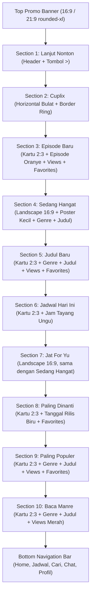

# DESIGN.md: Arsitektur & Spesifikasi UI Halaman Home (AnimeIn Android)

Dokumen ini mendefinisikan arsitektur desain, tata letak antarmuka, dan sistem desain untuk halaman **Home** aplikasi Android **AnimeIn**. Seluruh spesifikasi disusun berdasarkan referensi visual dan aturan ketat anti-slop dari `.agents/skills/anti-slop/SKILL.md`.

---

## 1. Identitas Visual & Liveliness Dials

Sesuai aturan *Part 3: Liveliness Toolkit* pada `SKILL.md`:

```text
Reading this as: Native Android Anime Streaming & Short Video App for Indonesian anime community, in a dense content-focused matte dark style, dial ENERGY 2 / RHYTHM 2 / MOTION 1.
```

* **ENERGY 2 (Balanced):** Tampilan gelap pekat bersih (*clean matte dark*), memprioritaskan karya seni poster anime dan thumbnail video, bebas dari efek dekoratif semrawut, border tebal tak berguna, atau gradien ungu-biru generik.
* **RHYTHM 2 (Structured & Varied):** Variasi ritme visual yang natural antar seksi (Banner Promo 16:9/21:9, Avatar Bulat Cuplix, Kartu Vertikal 2:3, Kartu Landscape Lebar 16:9, dan Kartu dengan Badge Spesifik).
* **MOTION 1 (Functional & Responsive):** Animasi fungsional (shimmer loading skeleton terukur, paging carousel mulus, dan touch feedback Material Ripple standar).

---

## 2. Tema & Palet Warna (Anti-Slop Dark UI)

Semua warna memiliki tujuan fungsional yang jelas dan memenuhi standar kontras WCAG AA (R-25):

| Token Warna | Nilai Hex | Fungsi & Keterangan |
| :--- | :--- | :--- |
| **Background Utama** | `#0B0B0B` / `#101010` | Hitam pekat bersih tanpa tumpukan kotak ber-border abu-abu tebal. Menjadi kanvas tunggal yang solid. |
| **Warna Aksen Utama** | `#FF5722` / `#FF6D3F` | Oranye kemerahan untuk teks episode, genre, border aktif, dan tab navigasi aktif. |
| **Indikator Views** | `#EF4444` | Ikon mata & teks merah untuk total penayangan (views) anime dan bacaan. |
| **Indikator Favorites** | `#FACC15` | Ikon bintang & teks kuning emas untuk metrik favorit pengguna. |
| **Indikator Jam Tayang** | `#A855F7` | Ikon jam & teks ungu pada seksi `Jadwal Hari Ini` (contoh: `10:00`). |
| **Indikator Tanggal Rilis** | `#3B82F6` | Ikon kalender & teks biru pada seksi `Paling Dinanti` (contoh: `2026-10-01`). |
| **Teks Primer** | `#FFFFFF` | Judul anime dan nama seksi (putih tebal, kontras tinggi). |
| **Teks Sekunder** | `#9CA3AF` | Keterangan tambahan dan teks pendukung. |
| **Background Nav / Control** | `#161616` | Background lingkaran gelap untuk tombol panah chevron dan bar navigasi bawah. |
| **Border Pemisah Tipis** | `rgba(255, 255, 255, 0.08)` | Garis batas 1dp tipis hanya untuk pemisah Bottom Nav (tanpa border tebal pada kartu). |

---

## 3. Tipografi & Ukuran Interaksi (Ergonomi Mobile)

* **Font Family:** San-Serif Sistem Android (Inter / Roboto).
* **Section Header:** 16sp, Semi-Bold, teks warna `#FFFFFF`.
* **Anime Title:** 12sp - 13sp, Bold, warna `#FFFFFF`, maksimal 2 baris dengan `ellipsize="end"`.
* **Tag Episode / Genre:** 11sp, Semi-Bold, warna `#FF5722` (Oranye kemerahan).
* **Statistik & Indikator:** 10sp, Medium, teks inline dengan ikon masing-masing metrik.
* **Touch Target:** Seluruh area interaktif (tombol panah, avatar Cuplix, kartu anime, dan menu navigasi) memiliki ukuran minimal 48dp x 48dp (R-03 & R-39).
* **Padding & Margin:**
  * Margin horizontal layar: 16dp.
  * Jarak vertikal antar seksi: 20dp.
  * Jarak horizontal antar kartu di carousel: 10dp.

---

## 4. Urutan Komponen Halaman Home (Dari Atas ke Bawah)

Struktur antarmuka halaman Home tersusun secara berurutan dan mengalir secara presisi:



---

### Rincian Spesifikasi Setiap Komponen:

### 1. Top Promo Banner
* **Rasio Gambar:** `16:9` atau `21:9` selebar layar (dengan margin 16dp kiri dan kanan) di bagian paling atas.
* **Bentuk:** Sudut membulat modern (`rounded-xl` / 14dp radius).
* **Tampilan:** Gambar banner promosi event, mini games, atau pengumuman fitur penting dengan rendering tajam.
* **Aksi:** Membuka detail promo / event yang bersangkutan saat diklik.

### 2. Section `Lanjut Nonton`
* **Header Seksi:**
  * Sisi kiri: Teks judul "Lanjut Nonton" (16sp, putih tebal).
  * Sisi kanan: Tombol ikon panah chevron `>` dengan background lingkaran gelap (`#161616`, diameter 32dp, touch target 48dp).
* **Konten:** 
  * Carousel horizontal episode terakhir yang ditonton beserta bilah progress pemutaran.
  * Jika riwayat tontonan kosong, seksi disembunyikan otomatis (*GONE*) untuk menghemat ruang vertikal (C-3).

### 3. Section `Cuplix`
* **Karakter Visual:** Baris horizontal berisi item bulat/lingkaran (diameter 60dp).
* **Ring Border:** Border ring tipis (1.5dp) berwarna aksen (`#FF5722` / oranye atau aksen status baru).
* **Isi:** Cuplikan video pendek yang diambil dari endpoint Cuplix (`/data/fyp2/list_scroll`).
* **Aksi:** Mengetuk salah satu lingkaran langsung memutar video reel vertikal Cuplix (endpoint `/data/fyp/server`).

### 4. Section `Episode Baru`
* **Karakter Visual:** Baris horizontal kartu poster vertikal dengan rasio `2:3`.
* **Prinsip Bersih (Anti-Slop):** Di bawah poster **tanpa background card yang kaku** atau box ber-border tebal. Konten langsung menyatu dengan canvas utama:
  1. Teks Oranye (`#FF5722`): `Episode [Nomor]` (11sp Semi-Bold).
  2. Judul Anime: Putih tebal (12sp Bold, maksimal 2 baris, `ellipsis`).
  3. Baris Statistik:
     * Baris Views: Ikon mata & teks Merah (`#EF4444`).
     * Baris Favorites: Ikon bintang & teks Kuning Emas (`#FACC15`).

### 5. Section `Sedang Hangat`
* **Karakter Visual:** Baris horizontal kartu landscape lebar dengan rasio `16:9` (lebar ~240dp, sudut membulat 10dp).
* **Struktur Tata Letak di Bawah Gambar Banner Lebar:**
  * **Sisi Kiri:** Poster kecil vertikal (rasio 2:3, lebar ~36dp, tinggi ~54dp, sudut membulat 4dp).
  * **Sisi Kanan:** 
    * Baris 1: Teks Genre warna Oranye (`#FF5722`, 10sp).
    * Baris 2: Judul Anime warna Putih tebal (12sp Bold, 1 baris terpotong rapi).
    * Baris 3: 1 baris terpadu berisi Views (ikon mata + teks merah `#EF4444`) dan Favorites (ikon bintang + teks kuning emas `#FACC15`).

### 6. Section `Judul Baru`
* **Karakter Visual:** Kartu poster vertikal (`2:3`) tanpa background box kaku.
* **Elemen Informasi (Di Bawah Poster):**
  1. Genre: Teks warna Oranye (`#FF5722`, 11sp).
  2. Judul Anime: Teks warna Putih tebal (12sp, maksimal 2 baris).
  3. Views: Ikon mata & teks Merah (`#EF4444`).
  4. Favorites: Ikon bintang & teks Kuning Emas (`#FACC15`).

### 7. Section `Jadwal Hari Ini`
* **Karakter Visual:** Kartu poster vertikal (`2:3`) tanpa background box kaku.
* **Elemen Informasi (Di Bawah Poster):**
  1. Genre: Teks warna Oranye (`#FF5722`, 11sp).
  2. Judul Anime: Teks warna Putih tebal (12sp, maksimal 2 baris).
  3. Views: Ikon mata & teks Merah (`#EF4444`).
  4. Favorites: Ikon bintang & teks Kuning Emas (`#FACC15`).
  5. Jam Tayang: Ikon jam & teks Ungu (`#A855F7`, contoh: `10:00`).

### 8. Section `Jat For Yu`
* **Karakter Visual:** Layout kartu landscape lebar yang sama persis dengan Section `Sedang Hangat`:
  * Banner lebar horizontal rasio `16:9`.
  * Di bawah banner lebar terdapat: Poster kecil vertikal di sisi kiri, di sisi kanannya terdapat genre (oranye), judul anime (putih tebal), dan 1 baris views (merah) + favorites (kuning).

### 9. Section `Paling Dinanti`
* **Karakter Visual:** Kartu poster vertikal (`2:3`) tanpa background box kaku.
* **Elemen Informasi (Di Bawah Poster):**
  1. Genre: Teks warna Oranye (`#FF5722`, 11sp).
  2. Judul Anime: Teks warna Putih tebal (12sp, maksimal 2 baris).
  3. Tanggal Rilis: Ikon kalender & teks Biru (`#3B82F6`, contoh: `2026-10-01`).
  4. Favorites: Ikon bintang & teks Kuning Emas (`#FACC15`).

### 10. Section `Paling Populer`
* **Karakter Visual:** Kartu poster vertikal (`2:3`) tanpa background box kaku.
* **Elemen Informasi (Di Bawah Poster):**
  1. Genre: Teks warna Oranye (`#FF5722`, 11sp).
  2. Judul Anime: Teks warna Putih tebal (12sp, maksimal 2 baris).
  3. Views: Ikon mata & teks Merah (`#EF4444`, angka penonton views jutaan).
  4. Favorites: Ikon bintang & teks Kuning Emas (`#FACC15`).

### 11. Section `Baca Manre`
* **Karakter Visual:** Kartu poster vertikal (`2:3`) untuk katalog manga/manhwa/komik.
* **Elemen Informasi (Di Bawah Poster):**
  1. Genre: Teks warna Oranye (`#FF5722`, 11sp).
  2. Judul: Teks warna Putih tebal (12sp, maksimal 2 baris).
  3. Views: Ikon buku/mata & teks Merah (`#EF4444`) untuk statistik pembaca.

### 12. Bottom Navigation Bar
* **Penempatan:** Menempel tetap di bagian paling bawah layar (*Fixed Bottom Bar*).
* **Background:** Hitam pekat solid (`#0B0B0B` / `#101010`) dengan garis pemisah tipis 1dp `rgba(255, 255, 255, 0.08)`.
* **5 Menu Navigasi:**
  1. `Home`: Ikon Rumah (Status Aktif: Teks & Ikon warna Oranye `#FF5722`).
  2. `Jadwal`: Ikon Kalender / Jadwal rilis (Warna `#9CA3AF`).
  3. `Cari`: Ikon Kaca Pembesar / Explore (Warna `#9CA3AF`).
  4. `Chat`: Ikon Balon Pesan / Diskusi (Warna `#9CA3AF`).
  5. `Profil`: Ikon User / Pengaturan (Warna `#9CA3AF`).
* **Ergonomi:** Tinggi bar 56dp - 64dp, dengan touch target setiap item minimal 48dp x 48dp (R-03 & R-39).

---

## 5. Pemetaan Endpoint Data API ke Komponen UI

Seluruh data komponen dihubungkan langsung ke scraper dan API yang tersedia di workspace:

| Komponen Home | Endpoint Sumber Data | Field Data Utama |
| :--- | :--- | :--- |
| **Top Promo Banner** | `GET /3/2/home/data` (`data.slider`) | `image`, `title`, `link`, `id_movie` |
| **Lanjut Nonton** | Local Cache / SharedPreferences | `id_movie`, `episode_id`, `progress_ms`, `image` |
| **Cuplix** | `GET /data/fyp2/list_scroll?limit=15&sort=new` | `id`, `url_thumbnail`, `id_fyp`, `anime` |
| **Episode Baru** | `GET /3/2/home/data` (`data.new`) | `id`, `title`, `image_poster`, `index`, `views`, `favorites` |
| **Sedang Hangat** | `GET /3/2/home/data` (`data.hot`) | `id`, `title`, `image_cover`, `image_poster`, `genre`, `views`, `favorites` |
| **Judul Baru** | `GET /3/2/home/data` (`data.new` / catalog) | `id`, `title`, `image_poster`, `genre`, `views`, `favorites` |
| **Jadwal Hari Ini** | `GET /3/2/home/data` (`data.today`) | `id`, `title`, `image_poster`, `genre`, `time`, `views`, `favorites` |
| **Jat For Yu** | `GET /3/2/home/data` (`data.fyp`) | `id`, `title`, `image_cover`, `image_poster`, `genre`, `views`, `favorites` |
| **Paling Dinanti** | `GET /3/2/home/data` (`data.waiting`) | `id`, `title`, `image_poster`, `genre`, `aired_start`, `favorites` |
| **Paling Populer** | `GET /3/2/home/data` (`data.popular`) | `id`, `title`, `image_poster`, `genre`, `views`, `favorites` |
| **Baca Manre** | API Scraper Manga / Manhwa | `id`, `title`, `image_poster`, `genre`, `views` |

---

## 6. Standar Penanganan Status UI (UI States — R-27)

* **Loading State:**
  * Komponen menggunakan animasi Shimmer Skeleton abu-abu gelap pekat (`#1A1C24`).
  * Proporsi skeleton dibuat presisi mengikuti bentuk kartu: rasio 2:3 untuk poster dan 16:9 untuk banner lebar (tanpa memakai spinner melayang di tengah layar).
* **Empty State:**
  * Jika data kosong pada seksi opsional (misalnya Lanjut Nonton), seksi otomatis disembunyikan (*GONE*).
* **Error State:**
  * Menampilkan teks pesan kegagalan yang sopan dan tombol aksi coba lagi ("Coba Lagi") dengan touch target minimal 48dp.

---

## 7. Arsitektur & Spesifikasi UI Halaman Detail Anime (Anime Detail Screen)

Sesuai analisa mendalam membandingkan referensi desain asli (`reff_ui/reff_uidetail/`: `WA0022`, `WA0024`, `WA0027`, `WA0029`) terhadap hasil evaluasi sebelumnya (`reff_uidetailgagal/`), halaman detail anime disempurnakan dengan arsitektur 100% presisi:

### 1. Full Screen / Edge-to-Edge Status Bar Transparan
* **Tampilan Penuh (Edge-to-Edge):** Menggunakan `enableEdgeToEdge()` dengan status bar transparan penuh sehingga gambar backdrop cover atas menyatu langsung hingga ujung atas layar perangkat (tanpa bilah hitam notifikasi yang memotong gambar).
* **Insets Padding:** Baris kontrol atas diberikan `statusBarsPadding()` agar tombol `Back`, pill status `ONGOING`, pill tipe `SERIES`, tombol bintang, dan tombol `Share` berada tepat di bawah jam dan indikator sinyal baterai tanpa terpotong.

### 2. Header / Hero Cover (Cover Landscape dengan Kontrol Bersih)
* **Visual Cover:** Gambar cover landscape (`image_cover`) diperbesar tingginya (~260dp) dengan gradasi hitam halus pekat di bagian bawahnya.
* **Top Control Bar (Melayang Bersih Tanpa Lingkaran Hitam):**
  * Sisi Kiri: Ikon panah kembali `Back` transparan bersih tanpa kotak lingkaran hitam (`ic_arrow_back`).
  * Sisi Kanan:
    * Status Pill: `ONGOING` (background abu-abu transparan `rgba(255, 255, 255, 0.18)`, teks putih 11sp semi-bold).
    * Type Pill: `SERIES` / `MOVIE` (background hijau tosca / teal `#0D9488`, teks putih 11sp semi-bold).
    * Action Favorite: Ikon bintang outline putih `Icons.Outlined.Star` transparan (kuning emas saat aktif).
    * Action Share: Ikon share putih transparan `Icons.Default.Share`.
* **Informasi Bawah Cover:**
  * Sisi Kiri:
    * Judul Anime: Teks putih tebal (18sp - 20sp Bold), maksimal 2 baris terpotong rapi.
    * Baris Statistik: Menggunakan vektor ikon bersih (bukan emoji), teks merah `[jumlah] views` (`#EF4444`) dan teks kuning emas `[jumlah] favorites` (`#FACC15`).
  * Sisi Kanan:
    * Tombol Play Putar: Lingkaran transparan dengan **border putih tipis dan ikon segitiga play outline putih** (diameter 44dp, tanpa background oranye tebal), dengan teks putih `ep 1` di bawahnya.

---

### 3. Scrollable TabBar (6 Tab Navigasi Bersih)
* **Daftar Tab:** `INFO`, `EPISODE`, `SEASON`, `CUPLIX`, `POSTER`, `COVER` (Tab `DISCUSSION` dan `CONTRIBUTOR` dihapus sepenuhnya dari halaman detail).
* **Karakter Tab:**
  * Horizontal scrollable bar dengan background kanvas solid pekat (`#0B0B0B`).
  * Indikator garis bawah oranye aktif (`#FF5722`, tebal 2.5dp).
  * Warna teks tab aktif: Oranye `#FF5722` (13sp Bold).
  * Warna teks tab non-aktif: Abu-abu `#9CA3AF` (13sp Medium).
  * Touch target tinggi tab minimal 48dp.

---

### 4. Spesifikasi Setiap Tab Halaman Detail

#### A. Tab `INFO`
* **Bagian Atas (Poster Besar & Judul):**
  * Sisi Kiri: Poster vertikal rasio `2:3` diperbesar ukurannya (~42%–45% lebar layar, sudut membulat 8dp).
  * Sisi Kanan:
    * Label `Judul` (abu-abu kebiruan, 11sp) dan di bawahnya Judul Utama (putih tebal, 14sp).
    * Label `Judul Alternatif` (abu-abu kebiruan, 11sp) dan di bawahnya Judul Sinonim (putih, 12sp).
* **Bagian Sinopsis & Metadata (Vertikal Rata Kiri / Left-Aligned):**
  * Seluruh baris disusun vertikal rata kiri (tanpa pemisah *space-between* kosong):
    * Label `Sinopsis`: Teks sinopsis lengkap warna `#D1D5DB` (12.5sp, line-height 18sp).
    * Label `Tipe`: Teks putih tebal `SERIES` / `MOVIE`.
    * Label `Aired Start`: Teks putih tebal tanggal rilis (contoh: `2026-10-02`).
    * Label `Aired End`: Teks putih tebal (contoh: `-` atau `2024-03-24`).
    * Label `Studios`: Teks putih tebal studio produksi (contoh: `Studio Pierrot`, `OLM`).
    * Label `Kategori`: Teks putih tebal biasa yang dipisahkan koma (contoh: `Action, Adventure, Comedy, Demons...`), **tanpa kotak chip/card**.
* **Floating Action Button (FAB):** Tombol lingkaran gelap di kanan bawah dengan ikon pensil/edit oranye.

#### B. Tab `EPISODE`
* **Pencarian & Urutan Episode:** Bar pencarian episode (`Cari nomor episode...`) dan pemilih urutan (`Terbaru / Terlama`) di bagian atas tab.
* **Pagination / Infinite Scroll:** Pemanggilan API otomatis memuat batch episode selanjutnya saat discroll ke bawah untuk anime ber-episode banyak (*One Piece*, *Conan*, dll.) hingga episode 1 tuntas.
* **Layout Grid 3 Kolom:**
  * Kartu thumbnail rasio 1:1 dengan sudut membulat halus (~12dp radius).
  * Badge nomor episode putih tebal di kanan bawah.
  * Pita merah `NEW` di kiri atas untuk episode terbaru.
  * Placeholder siluet serigala AnimeIn jika gambar episode belum tersedia.

#### C. Tab `SEASON`
* **Layout Kartu Landscape (16:9):**
  * Sudut membulat modern (12dp radius).
  * Judul musim di pojok kiri bawah dengan **font SANGAT BESAR dan TEBAL (Bold 22sp–24sp)** (contoh: `Season 1`, `Mini Anime`, `Season 2`, `Collab`).
  * Tepat di sebelah kanan judul besar tersebut, terdapat 2 baris bertumpuk vertikal:
    * Baris atas: `▶ [views] views` (merah).
    * Baris bawah: `★ [favorites] favorites` (kuning emas).

#### D. Tab `CUPLIX`
* Grid 3 kolom vertikal kartu cuplikan bersih murni gambar **tanpa ikon dan angka suka (`♡`)**.

#### E. Tab `POSTER` & `COVER` + Full Screen Preview
* **Tampilan Gambar Murni (Pure Images):** Menghilangkan seluruh teks uploader, badge donatur, angka poin (`145 P`), tombol upvote (`▲`), dan tombol floating tambah/filter.
* **Full Screen Image Preview:** Mengklik poster atau cover mana pun akan membuka mode layar penuh (*Full Screen Preview*). Mengklik kembali gambar di layar penuh akan menutup preview.

---

## 8. Arsitektur & Spesifikasi UI Halaman Streaming (Custom Video Player)

Halaman streaming dibangun presisi berdasarkan referensi visual `reff_uistreaming/` (`WA0035`, `WA0036`, `WA0037`, `Screenshot_083533`, `Screenshot_083616`):

### 1. Custom Video Player (Media3 / ExoPlayer 16:9)
* **Permukaan Video:** Player responsif rasio aspek `16:9` menggunakan Jetpack Compose `AndroidView` dan Media3 ExoPlayer.
* **Custom Video Controls:**
  * Tombol Play/Pause di kiri bawah.
  * Waktu berjalan (`01:00`) dan total durasi (`24:02`).
  * *Seekbar* / slider kemajuan video dengan warna aktif tosca / teal (`#26A69A`).
  * Pengatur kecepatan pemutaran (`1.0x`, `1.25x`, `1.5x`, `2.0x`).
  * Tombol Ikon Gerigi (Settings):
    * **Auto Next Episode:** Switch On/Off otomatis memutar episode selanjutnya.
    * **Lock Screen:** Opsi kunci layar sentuh (hanya aktif saat mode **Full Screen**).
  * Tombol Full Screen (mode landscape / layar penuh).

### 2. Info Episode & 2 Tombol Aksi
* **Info Header Episode:**
  * Judul Episode: `Episode [Nomor]` (teks putih tebal, 18sp).
  * Baris Metrik: Tanggal rilis warna tosca (contoh: `30 Oct 2026`) dan jumlah penayangan warna merah (contoh: `4874 views`).
* **Hanya 2 Tombol Aksi:**
  1. **`SERVER`:** Kotak gelap rounded dengan ikon chip/gear oranye `#FF5722` untuk memilih resolusi/server.
  2. **`LOVE IT`:** Kotak gelap rounded dengan ikon bintang outline oranye `#FF5722` untuk memberi rating episode (1–5 bintang).

### 3. Panel Pilih Server & Sinkronisasi Durasi
* **Tampilan Panel `Pilih Server`:**
  * Muncul di area atas player saat tombol `SERVER` ditekan (dengan tombol `X` di kanan atas).
  * Kolom vertikal berdampingan menampilkan: Nama uploader (`Shizukana`), ikon Play, nama server (`RAPSODI`), serta pilihan resolusi (`360p direct`, `480p direct`, `720p direct`, `1080p direct`).
  * Server aktif ditandai ikon play oranye.
* **Sinkronisasi Durasi Otomatis:** Saat resolusi atau server berganti, player membaca `currentPosition` dan melanjutkan pemutaran di detik yang sama tanpa mengulang dari detik ke-0.

### 4. Bagian `COVER & POSTER`
* Header `COVER & POSTER` dengan tombol menu titik tiga (`⋮`) di sisi kanan.
* Kartu Poster vertikal (kiri) dan Cover landscape (kanan) murni gambar.
* Mengklik langsung membuka *Full Screen Preview*.
* Mengklik titik tiga (`⋮`) atau menahan area membuka tampilan galeri lengkap (`POSTER` / `COVER`) dengan tombol kembali `<-`.

### 5. Bagian Komentar (`COMMENTS`) & Sub-View Balasan
* Header `COMMENTS ([Jumlah])` dengan ikon filter/sort di kanan.
* **Avatar Animasi:** Menggunakan Coil `GifDecoder` / `ImageDecoderDecoder` sehingga avatar Pokemon/profil pengguna bergerak (*animated GIF / WebP*).
* Komponen komentar: Avatar profil bergerak, username, waktu (`8 hours ago`), isi komentar, tombol jempol like (👍) beserta jumlah, tombol dislike (👎), dan tombol `[Jumlah] Balasan`.
* **Sub-View Balasan:** Mengetuk tombol `[Jumlah] Balasan` membuka tampilan percakapan balasan komentar dengan input teks `Tulis Balasan..`.

---

## 9. Pemetaan Endpoint Data API Detail & Streaming

| Fitur / Komponen | Endpoint Sumber Data | Field Response Utama |
| :--- | :--- | :--- |
| **Info Detail Anime** | `GET /3/2/movie/detail/{id}` | `data.movie`, `data.season` |
| **Daftar Episode (Pagination)** | `GET /3/2/movie/episode/{id}?page={page}` | `data.episode` (`id`, `index`, `title`, `views`, `image`, `is_new`) |
| **Stream Video & Server** | `GET /3/2/episode/streamnew/{idEpisode}` | `data.episode`, `data.server` (`link`, `quality`, `name`, `type`, `username`) |
| **Komentar Episode** | `GET /3/2/comment/data?id_episode={id}&page=0&sort=new` | `data.comment` (`id`, `user_name`, `user_pokemon`, `text`, `time`, `like`, `dislike`, `replay`) |
| **Balasan Komentar** | `GET /data/comment_replay/data?id_comment={id}&page=1` | `data.comment_replay` (`id`, `user_name`, `user_pokemon`, `text`, `time`, `like`) |
| **Cuplix per Anime** | `GET /data/movie/fyp/list_new?id_movie={id}&page=1` | `data.fyp` (`id`, `caption`, `url_thumbnail`) |
| **Poster Komunitas** | `GET /3/2/movie_poster/data?id_movie={id}` | `data.poster` (`id`, `image`) |
| **Cover Komunitas** | `GET /3/2/movie_cover/data?id_movie={id}` | `data.cover` (`id`, `image`) |


